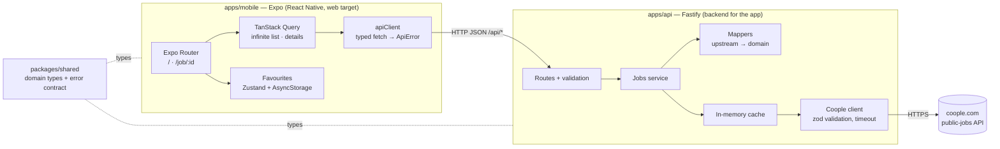

# Coople Jobs

A small app that lists public [Coople](https://www.coople.com) jobs, shows the details of each job on its own page, and lets you mark jobs as **favourites**. It is a React Native (Expo) app that runs on the web, backed by a small Node/TypeScript API.

|  |  |  |
| - | - | - |
|  |  |  |
|  |  |  |

More states: [network error](docs/media/error-network.png) · [invalid link](docs/media/invalid-link.png).

## Quick start

You need **Node 24** (the version in [`.nvmrc`](.nvmrc); `nvm use` picks it up) and npm.

```bash
npm install
npm run dev
```

Then open [http://localhost:8081](http://localhost:8081). `npm run dev` starts both parts:

| Part    | Address                                                         | What it is                        |
| ------- | --------------------------------------------------------------- | --------------------------------- |
| API     | [http://localhost:4000/api/jobs](http://localhost:4000/api/jobs) | Fastify server in front of Coople |
| Web app | [http://localhost:8081](http://localhost:8081)                   | Expo (React Native Web)           |

- The first load of the web app is slow, because Metro builds the bundle on demand.
- **Deep link:** a job opens directly at `http://localhost:8081/job/<id>`, for example `http://localhost:8081/job/2c92cf2f-5073-4842-bedd-580e3a8feea9` (job ids come from the list; old ones expire when the job ends).
- **Configuration is optional.** Both apps work with their defaults. To change something, copy the examples and edit them: `apps/api/.env.example` → `apps/api/.env` (port, allowed web origin, Coople URL, timeouts, cache lifetimes) and `apps/mobile/.env.example` → `apps/mobile/.env` (`EXPO_PUBLIC_API_URL`, the API address the app calls).

### Scripts

Run from the repository root.

| Command                  | What it does                                                 |
| ------------------------ | ------------------------------------------------------------ |
| `npm run dev`          | Start the API and the web app together                       |
| `npm test`             | Run all tests (API with Vitest, app with Jest)               |
| `npm run typecheck`    | TypeScript check of every workspace                          |
| `npm run lint`         | ESLint                                                       |
| `npm run format:check` | Check formatting with Prettier (`npm run format` fixes it) |

The same four checks run in CI on every push to `main` and every pull request ([`.github/workflows/ci.yml`](.github/workflows/ci.yml)).

## Architecture



An npm-workspaces monorepo:

```
apps/api          Fastify API: routes, service, mappers, Coople client, cache
apps/mobile       Expo app: routes in src/app, features in src/features, shared code (theme, API client, UI) in src/shared
packages/shared   TypeScript types shared by both sides (the contract between them)
```
