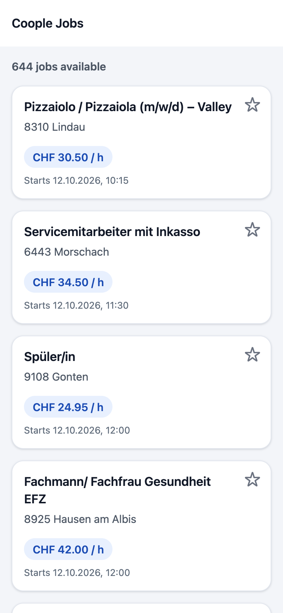
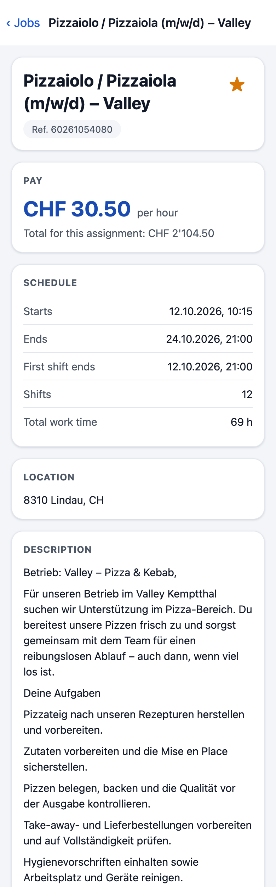
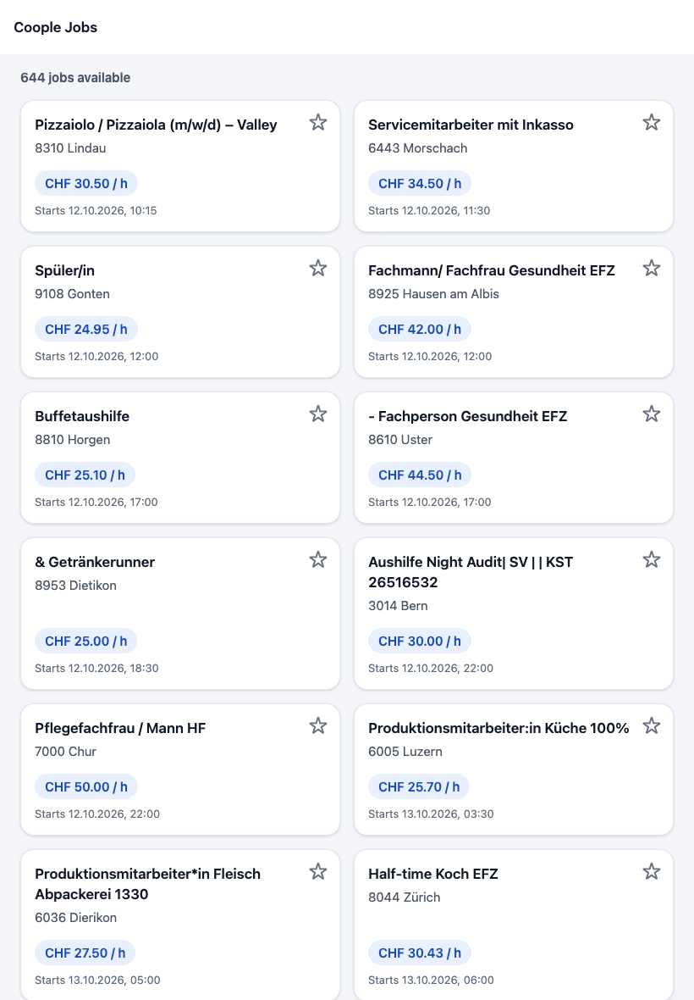
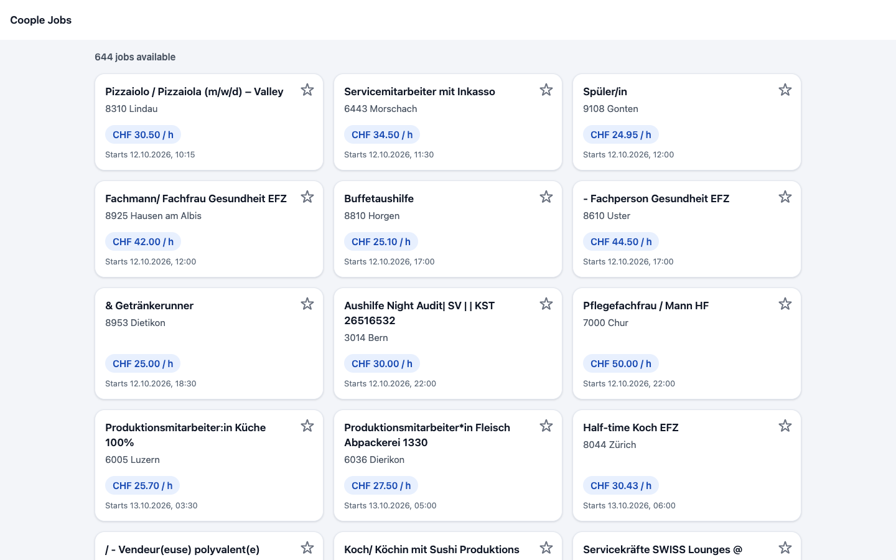
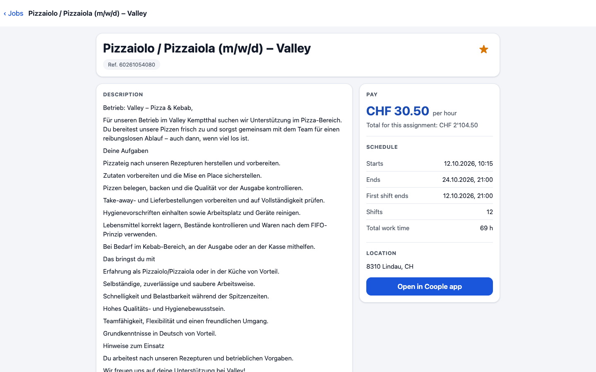
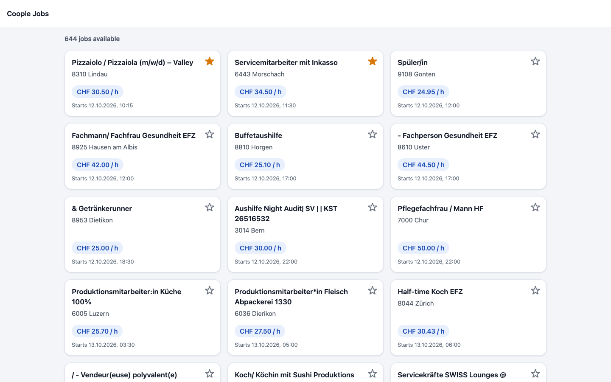
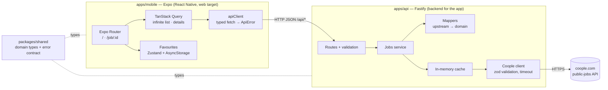

# Coople Jobs

A small app that lists public [Coople](https://www.coople.com) jobs, shows the details of each job on its own page, and lets you mark jobs as **favourites**. It is a React Native (Expo) app that runs on the web, backed by a small Node/TypeScript API.

|                                                                                   |                                                                                         |                                                                                                    |
| --------------------------------------------------------------------------------- | --------------------------------------------------------------------------------------- | -------------------------------------------------------------------------------------------------- |
|      |      |          |
|  |  |  |

More states: [network error](docs/media/error-network.png) · [invalid link](docs/media/invalid-link.png).

## Quick start

You need **Node 24** (the version in [`.nvmrc`](.nvmrc); `nvm use` picks it up) and npm.

```bash
npm install
npm run dev
```

Then open <http://localhost:8081>. `npm run dev` starts both parts:

| Part    | Address                          | What it is                        |
| ------- | -------------------------------- | --------------------------------- |
| API     | <http://localhost:4000/api/jobs> | Fastify server in front of Coople |
| Web app | <http://localhost:8081>          | Expo (React Native Web)           |

- The first load of the web app is slow, because Metro builds the bundle on demand.
- **Deep link:** a job opens directly at `http://localhost:8081/job/<id>`, for example `http://localhost:8081/job/2c92cf2f-5073-4842-bedd-580e3a8feea9` (job ids come from the list; old ones expire when the job ends).
- **Configuration is optional.** Both apps work with their defaults. To change something, copy the examples and edit them: `apps/api/.env.example` → `apps/api/.env` (port, allowed web origin, Coople URL, timeouts, cache lifetimes) and `apps/mobile/.env.example` → `apps/mobile/.env` (`EXPO_PUBLIC_API_URL`, the API address the app calls).
- To try the app on a phone with Expo Go, set `EXPO_PUBLIC_API_URL` to your computer's address on the local network (for example `http://192.168.1.20:4000`) instead of `localhost`. I tested the web build in a browser; I did not test on a physical device.

### Scripts

Run from the repository root.

| Command                | What it does                                               |
| ---------------------- | ---------------------------------------------------------- |
| `npm run dev`          | Start the API and the web app together                     |
| `npm test`             | Run all tests (API with Vitest, app with Jest)             |
| `npm run typecheck`    | TypeScript check of every workspace                        |
| `npm run lint`         | ESLint                                                     |
| `npm run format:check` | Check formatting with Prettier (`npm run format` fixes it) |

The same four checks run in CI on every push to `main` and every pull request ([`.github/workflows/ci.yml`](.github/workflows/ci.yml)).

## Architecture



An npm-workspaces monorepo:

```
apps/api          Fastify API: routes, service, mappers, Coople client, cache
apps/mobile       Expo app: routes in src/app, screens in src/features, theme in src/theme
packages/shared   TypeScript types shared by both sides (the contract between them)
```

### Why there is a backend

The Coople API cannot be called from a browser: its answers carry no `Access-Control-Allow-Origin` header, and the preflight request is answered with `401`. A web app would be blocked by CORS, so the API sits in between (server-to-server calls are not subject to CORS). That also lets it absorb the quirks of the upstream in one place:

- Every answer is wrapped in an envelope (`{ status, data, error, … }`), which the API unwraps.
- Dates arrive as epoch milliseconds and currencies and countries as numeric ids; the API turns them into ISO 8601 and `CHF` / `CH`, and empty strings into `null`.
- A malformed job id makes Coople answer `401 Authentication_error`, which is misleading. The API validates the id first and answers `400 INVALID_JOB_ID`.

The app only ever sees the clean domain model from `packages/shared`.

### How data flows

1. **List.** `GET /api/jobs?page=0&pageSize=30` → Coople list → validated with zod → mapped to `JobSummary` → `Page<JobSummary>`. The app loads 30 jobs at a time and fetches the next page when you scroll near the end (TanStack Query `useInfiniteQuery`).
2. **Details.** `GET /api/jobs/:id` → `JobDetails`. When a job is opened from the list, its title, pay and location show immediately from the list data while the rest loads.
3. **Caching.** The API keeps successful Coople answers in memory (60 s for the list, 5 min for details, configurable; concurrent identical requests share one upstream call; failures are never cached). Successful answers carry `Cache-Control`, errors carry `no-store`.
4. **Favourites** are stored on the device (Zustand with `persist`; AsyncStorage, which is `localStorage` on the web), under a versioned key. Stored data is validated when it is read, so corrupt data cannot crash the app, and the stars stay hidden until the stored favourites are loaded so they never flicker. There are no user accounts in this task, so a server-side list would not belong to anyone. A server-side version (anonymous device id + database + optimistic updates) was built and then deliberately dropped as too much machinery for this scope.

### Errors and loading states

Upstream failures are translated into stable error codes the app can act on (the full list is in [`packages/shared`](packages/shared/src/index.ts)).

| Situation                                | API answer                               | What the user sees                              |
| ---------------------------------------- | ---------------------------------------- | ----------------------------------------------- |
| Job id is not a UUID                     | `400 INVALID_JOB_ID` (Coople not called) | "This link is not valid." + **Back to jobs**    |
| Job does not exist                       | `404 JOB_NOT_FOUND`                      | "This job no longer exists." + **Back to jobs** |
| Coople down or answering with an error   | `502 UPSTREAM_UNAVAILABLE`               | Message + **Retry**                             |
| Coople too slow (8 s)                    | `504 UPSTREAM_TIMEOUT`                   | Message + **Retry**                             |
| Coople sends data of an unexpected shape | `502 UPSTREAM_INVALID_RESPONSE`          | Message + **Retry**                             |
| API unreachable                          | —                                        | "We can't reach the server…" + **Retry**        |
| No jobs                                  | `200` with an empty list                 | "No jobs available right now" + **Retry**       |

Retries only happen for errors that a retry can fix (network problems and 5xx, at most twice); a 4xx answer is never retried. If a refresh fails while jobs are on screen, they stay visible with a short notice, and a failing next page shows a **Retry** at the bottom of the list. Data from Coople is validated with zod, so a changed upstream cannot put `undefined` or `NaN` on the screen; optional fields are simply hidden.

### Layout

The layout adapts to the window width, live, with no reload:

| Width        | List      | Details                                                      |
| ------------ | --------- | ------------------------------------------------------------ |
| under 600 px | 1 column  | one column                                                   |
| 600–1023 px  | 2 columns | one column, centred                                          |
| 1024 px up   | 3 columns | two columns: description on the left, key facts on the right |

Colours, spacing and type sizes come from one small token file ([`apps/mobile/src/theme/tokens.ts`](apps/mobile/src/theme/tokens.ts)); a unit test checks that every text colour pair meets WCAG AA contrast. Times are shown in Swiss time (`Europe/Zurich`) whatever the viewer's timezone, and money in Swiss format.

## Tests

`npm test` runs about 330 tests:

- **API (Vitest):** the Coople client (success, 404, 5xx, error flag with HTTP 200, wrong shape, timeout, unknown fields), the mappers, every route and its error answers, the cache and the headers. Fixtures are real Coople answers.
- **App (Jest + React Native Testing Library):** the API client and its retry rules, formatters, the error messages, the infinite-list and favourites logic, and the screens themselves — loading, error, empty, success, scrolling to further pages, refresh, the details page with and without optional fields, and the layout at each width.

Not covered by automated tests: how things look and feel in a real browser. I checked that by running the app in headless Chrome against the real Coople API: list and details at 360, 768, 1280 and 1920 px, live resizing, keyboard focus, favourites surviving a reload, all four job URLs, the network error with Retry, and scrolling through several pages including a failing page.

## Trade-offs and what I would do next

- **Favourites are per browser**, not per person. Sharing them across devices needs accounts (or at least an anonymous id plus storage on the server), rate limiting and a decision about what happens to favourites whose job has ended; storing a small snapshot of each favourite job would let them outlive the listing.
- **The cache lives in the API process.** Several API instances would each have their own; a shared cache (for example Redis) and serving slightly stale data while Coople is down would be the next resilience steps.
- **Job content is German, the interface is English.** Strings are not extracted for translation yet.
- **Light theme only.** Because colours come from tokens, a dark theme is a contained change.
- **Opaque ids** (`jobProfileId`, `educationalLevelId`) are not shown, because Coople offers no way to turn them into names.
- **End-to-end tests** (for example Playwright against the web build) and screenshot comparisons per screen width would protect the layout against regressions.
- `npm audit` reports vulnerabilities in the React Native / Expo toolchain (development dependencies); I did not run `npm audit fix`, since it can break the Expo-pinned versions.

## How this was built

Built with [Claude Code](https://claude.com/claude-code) (Anthropic's coding agent), following a written step-by-step plan: one commit per step, each checked with typecheck, lint and tests; the finished UI was then checked in a real browser (headless Chrome) against the live Coople API. Every step was committed by the author, who also decided what to keep and what to cut. The repository contains the code only; the plan file is kept out of version control.
